# Jason

```text
JASON / DESIGN WORKSPACE
────────────────────────────────────────────
source      github.com/jasonfesta/design-agents
install     jason/
format      portable Markdown + local React tools
```

Three folders. Start with an agent, browse the resources it needs, and run a local tool when the work calls for it.

**[Inspiration — WebGL / shaders, Product, and Websites](resources/inspiration.md)** · All collected images, videos, websites, and download links.

**[Browse Atlas — apps, websites, and games](agents/ATLAS.md#full-atlas)** · Every category, interface subcategory, and style family on one page. [Download the diagrams as PNGs](#diagram-pngs).

```text
jason/
├── README.md
├── AGENTS.md                     IDE instructions
├── agents/
│   ├── SETUP.md                  Install this kit as jason/
│   ├── ATLAS.md                  Complete Atlas overview and nomenclature
│   ├── TASTE.md                  References and design direction
│   ├── DIAL.md                   React components and layouts
│   ├── DREAM.md                  Separate cleanup candidate for review
│   ├── BENCHMARK.md              Compare models against a selected layout
│   └── memory/                   Evidence, decisions, and coverage
├── resources/
│   ├── structure.md              Six-layer design hierarchy
│   ├── diagrams/                 Individual GitHub-dark PNG downloads
│   ├── apps/                     README · categories · subcategories · styles
│   ├── games/                    README · categories · subcategories · styles
│   ├── websites/                 README · categories · subcategories · styles
│   ├── devices/                  Mobile · tablet · desktop · TV
│   ├── viewports/                Numeric sizes and Chrome device presets
│   ├── styles/                   Shared visual vocabulary
│   ├── motion/                   Techniques and motion references
│   ├── sites.md                  Collected design-site directory
│   ├── skills.md                 Installed instructions and pointers
│   ├── mcps/                     MCP research and setup records
│   ├── agents/                   External agent and craft references
│   ├── tools/                    Tool research and setup records
│   ├── jigs/                     Shared layout review UI
│   ├── guides/                   Working methods
│   ├── sources/                  Source records and collections
│   └── history/                  Preserved earlier material
└── tools/
    ├── benchmark/                Runnable React tool and jig preview
    └── workspace.py              Catalogue, checks, and transfer
```

`.agents/skills/` holds the bundled skills where compatible IDEs discover them. `workspace.json` and `.gitignore` handle portability and local files; they are implementation details, not extra places to browse.

This is the portable tree. Existing machine-local tool checkouts remain under `tools/` and are excluded from the GitHub package. Shared reference menus live in this kit; actual app, website, and game projects use the destination recorded for their build chat.

## Start

Give an assistant [agents/SETUP.md](agents/SETUP.md) and say: **Set up Jason here.** It fetches `jasonfesta/design-agents` from `main` into `jason/`, preserving existing work. The repository and branch are confirmed. Setup verifies the downloaded revision and reports tool readiness separately; installation across all supported operating systems remains untested.

Already have the kit? Read [agents/README.md](agents/README.md) and load the role you need. Roles remain portable Markdown for later skill conversion.

## Folder map

| I need… | Open |
| --- | --- |
| The six agent roles | [Agents](agents/README.md) |
| All categories, subcategories, and styles across the three types | [Full Atlas](agents/ATLAS.md#full-atlas) |
| The six-layer schema and project folder rules | [Structure](resources/structure.md) |
| App product categories and interface families | [Apps](resources/apps/README.md) |
| Game genres | [Games](resources/games/README.md) |
| Website uses | [Websites](resources/websites/README.md) |
| Resources and filing rules | [Resources](resources/README.md) |
| Visual references, images, and video downloads | [Inspiration](resources/inspiration.md) |
| Collected design sites, grouped by type | [Design sites](resources/sites.md) |
| MCPs, skills, or supporting agent references | [MCPs](resources/mcps/README.md) · [Skills](resources/skills.md) · [Agent resources](resources/agents/README.md) |
| Local preview or model comparison | [Tools](tools/README.md) |

## Design structure

[Open the full Atlas](agents/ATLAS.md#full-atlas) for the expanded [app](agents/ATLAS.md#apps), [website](agents/ATLAS.md#websites), and [game](agents/ATLAS.md#games) trees.

```text
design type                       apps / games / websites
└── device type                   mobile / tablet / desktop / tv
    └── viewport size             width × height
        └── category              product / genre / website use
            └── subcategory       interface family
                └── style         visual treatment
```

These definitions live in Resources. Actual product code, selected references, layouts, and versions live in the project destination you choose. Each new build chat owns one app, website, or game. Follow [project locations](agents/README.md#project-locations); roles reuse that destination.

The workflow is **Taste ↔ Atlas → Dial → Dream**. Benchmark compares models against a saved Dial layout when requested. The shared jig and local Benchmark tool run today; the full reference-to-kit workflow still needs an end-to-end implementation, and Dream scheduling is not configured.

## Maintenance and transfer

```sh
python3 tools/workspace.py catalogue
python3 tools/workspace.py check
python3 tools/workspace.py export
```

The export is `.exports/jason.zip`; run `python3 tools/workspace.py verify` inside an extracted kit. Dependencies, credentials, private benchmark results, and local installations stay local. [History](resources/history/README.md) preserves prior material and source snapshots.

## Diagram PNGs

Direct screenshots of the existing GitHub Markdown in **GitHub dark mode**, cropped to each diagram or table at **2× resolution**. Every image is shown in full below. Select its download link to open the original PNG.

[Source and capture details](resources/diagrams/README.md)

### Atlas, Taste, Dial, Dream, Benchmark: use and result

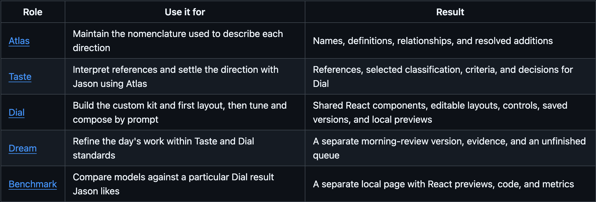

[Download PNG](resources/diagrams/agent-roles.png?raw=1)

### Atlas: role, input, and output

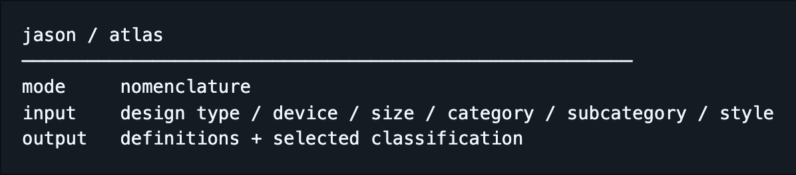

[Download PNG](resources/diagrams/atlas.png?raw=1)

### Atlas: six-layer main structure

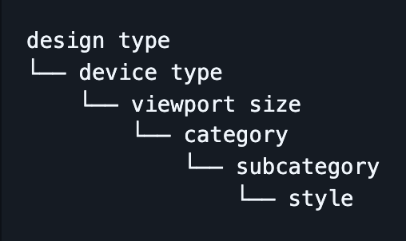

[Download PNG](resources/diagrams/atlas-main-structure.png?raw=1)

### Apps: complete category, subcategory, and style menu

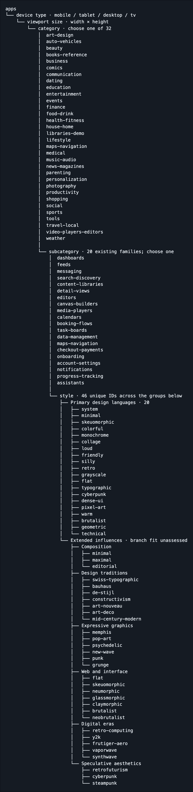

[Download PNG](resources/diagrams/apps.png?raw=1)

### Websites: complete category, subcategory, and style menu

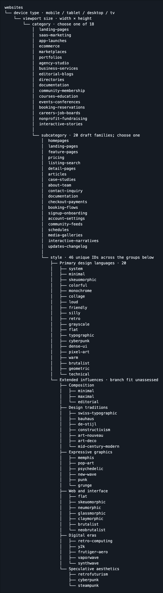

[Download PNG](resources/diagrams/websites.png?raw=1)

### Games: complete category, subcategory, and style menu

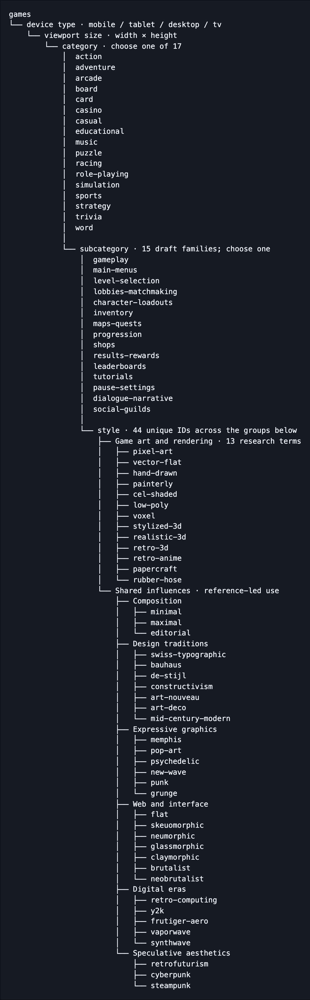

[Download PNG](resources/diagrams/games.png?raw=1)

### Workspace: full folder map

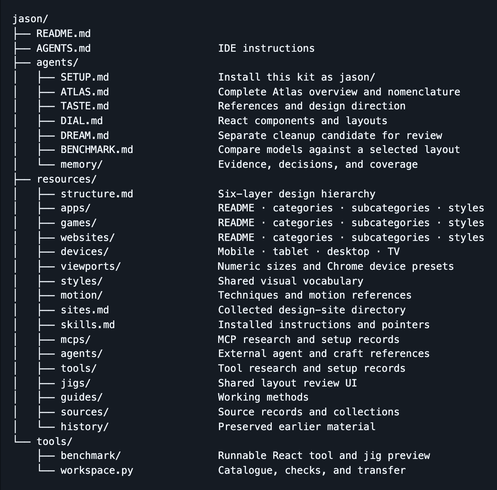

[Download PNG](resources/diagrams/workspace-structure.png?raw=1)

### Design structure: six layers with their meanings

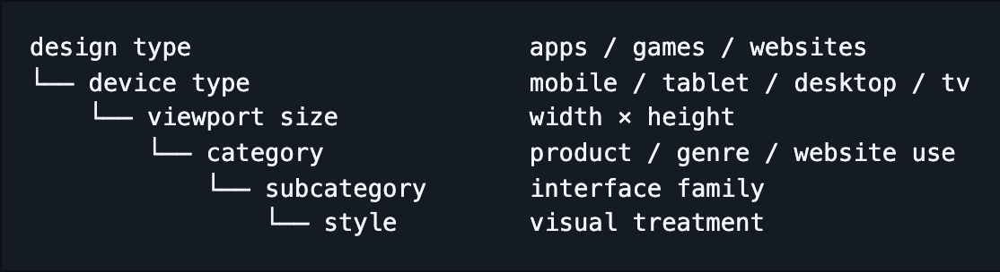

[Download PNG](resources/diagrams/design-structure.png?raw=1)

### Agents: role-file map

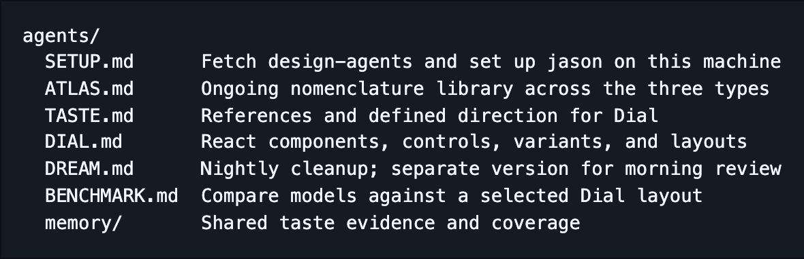

[Download PNG](resources/diagrams/agents-structure.png?raw=1)

### Resources: complete folder map

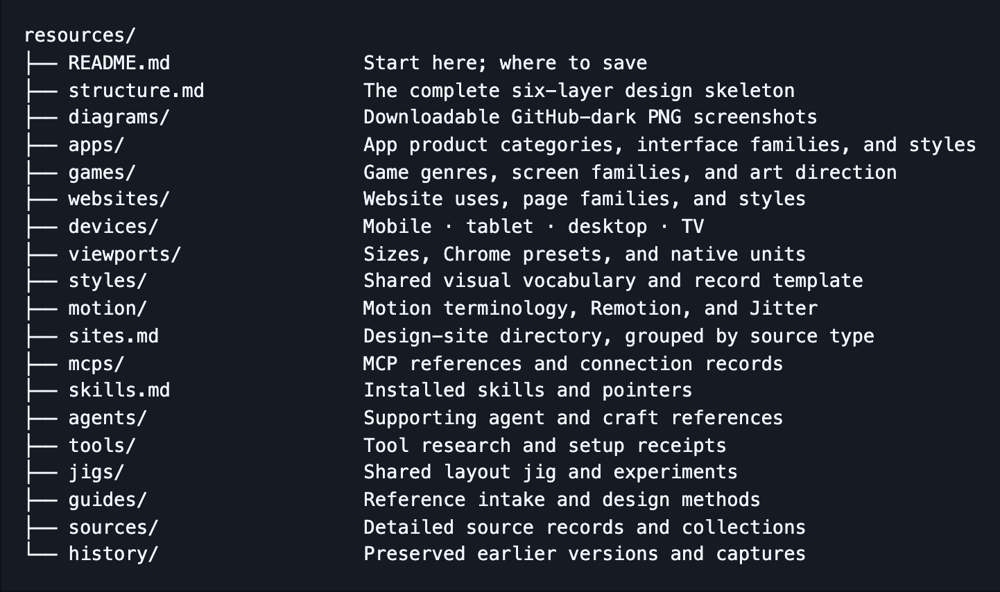

[Download PNG](resources/diagrams/resources-structure.png?raw=1)

### Tools: portable tool map

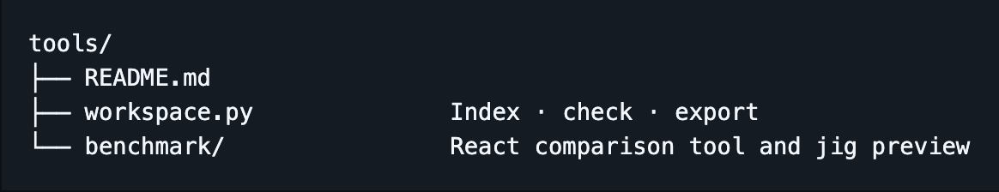

[Download PNG](resources/diagrams/tools-structure.png?raw=1)

### Project: selected branch folder template

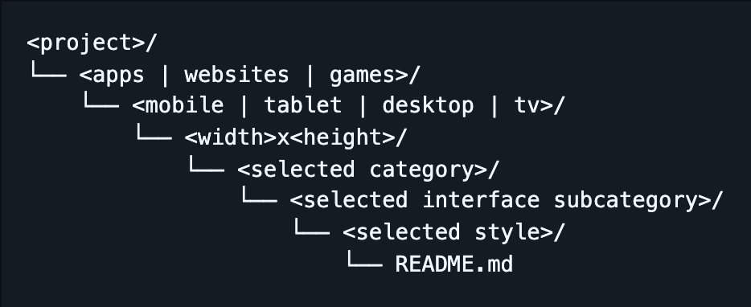

[Download PNG](resources/diagrams/project-branch.png?raw=1)

### Read a path: annotated six-layer example

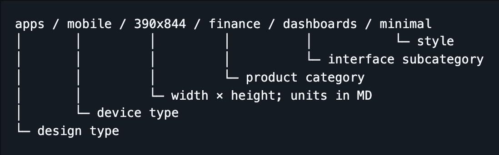

[Download PNG](resources/diagrams/read-a-path.png?raw=1)

## Motion and website downloads

**[Browse everything in Inspiration](resources/inspiration.md)** — organized as [WebGL / shaders](resources/inspiration.md#webgl--shaders) [Product](resources/inspiration.md#product), and [Websites](resources/inspiration.md#websites).

[Open the single Markdown collection](resources/sources/motion-references/README.md) · [Download / copy the Markdown](https://github.com/jasonfesta/design-agents/raw/refs/heads/main/resources/sources/motion-references/README.md)

Fourteen supplied X posts, their quoted media, seven websites, and the jelly-glass demo are collected below. Expand the website galleries to view and download individual images and videos. The separate UI collection follows at the bottom. Collected October 13, 2026.

| Reference / original post | Download | Public email |
| --- | --- | --- |
| [dnatsu · WebGL / Three.js experiment](https://x.com/dnatsuuu/status/2095073497982935069) | [MP4](https://github.com/jasonfesta/design-agents/raw/refs/heads/main/resources/sources/motion-references/videos/dnatsuuu-2095073497982935069.mp4) | Not publicly found |
| [Shader Sweden · jelly-glass carousel](https://x.com/shadersweden/status/2095293113086431603) | [MP4](https://github.com/jasonfesta/design-agents/raw/refs/heads/main/resources/sources/motion-references/videos/shadersweden-2095293113086431603.mp4) | [hello@shader.se](mailto:hello@shader.se) |
| [Basit A. Khan · design exploration](https://x.com/basit_designs/status/2095435397828628584) | [MP4](https://github.com/jasonfesta/design-agents/raw/refs/heads/main/resources/sources/motion-references/videos/basit_designs-2095435397828628584.mp4) | [hello@inspirux.com](mailto:hello@inspirux.com) |
| [Anton Proshkuratov · endless canvas](https://x.com/prszkrtw/status/2094754060188401708) | [MP4](https://github.com/jasonfesta/design-agents/raw/refs/heads/main/resources/sources/motion-references/videos/prszkrtw-2094754060188401708.mp4) | [prszkrtw@gmail.com](mailto:prszkrtw@gmail.com) |
| [Basit A. Khan · gradient card](https://x.com/basit_designs/status/2099771881159098710) | [MP4](https://github.com/jasonfesta/design-agents/raw/refs/heads/main/resources/sources/motion-references/videos/basit_designs-2099771881159098710.mp4) | [hello@inspirux.com](mailto:hello@inspirux.com) |
| [Sergei Semenov · money animation](https://x.com/Hollysem/status/2109628383156170792) | [MP4](https://github.com/jasonfesta/design-agents/raw/refs/heads/main/resources/sources/motion-references/videos/hollysem-2109628383156170792.mp4) | [ssemenov@me.com](mailto:ssemenov@me.com) |
| [60fps · Plasma flag carousel](https://x.com/60fpsdesign/status/2109604725880762373) | [MP4](https://github.com/jasonfesta/design-agents/raw/refs/heads/main/resources/sources/motion-references/videos/60fpsdesign-2109604725880762373.mp4) | [admin@60fps.design](mailto:admin@60fps.design) |
| [Rashi · cutting and pasting](https://x.com/dezinbyrashi/status/2109607368480920020) | [MP4](https://github.com/jasonfesta/design-agents/raw/refs/heads/main/resources/sources/motion-references/videos/dezinbyrashi-2109607368480920020.mp4) | [sayhi@rashi.design](mailto:sayhi@rashi.design) |
| [Rico® Supply · Movo motion experiment](https://x.com/RicoSupply/status/2109532017582866591) | [MP4](https://github.com/jasonfesta/design-agents/raw/refs/heads/main/resources/sources/motion-references/videos/ricosupply-2109532017582866591.mp4) | [hello@rico.supply](mailto:hello@rico.supply) |
| [Edgex · kiwi jelly comparison](https://x.com/SahilExec/status/2109949445853110629) | [MP4](https://github.com/jasonfesta/design-agents/raw/refs/heads/main/resources/sources/motion-references/videos/sahilexec-2109949445853110629.mp4) | Not publicly found |
| [Ann Nguyen · holographic CD study](https://x.com/ann_nnng/status/2109853948647711057) | [MP4](https://github.com/jasonfesta/design-agents/raw/refs/heads/main/resources/sources/motion-references/videos/ann_nnng-2109853948647711057.mp4) | Not publicly found |
| [Ian Curtis · WebGPU portal cube](https://x.com/XRarchitect/status/2109828750657654819) | [MP4](https://github.com/jasonfesta/design-agents/raw/refs/heads/main/resources/sources/motion-references/videos/xrarchitect-2109828750657654819.mp4) | [ianjamescurtis1@gmail.com](mailto:ianjamescurtis1@gmail.com) |
| [The Brand Identity · Rico Jitter templates](https://x.com/TweetsByTBI/status/2100751700831453345) | [MP4](https://github.com/jasonfesta/design-agents/raw/refs/heads/main/resources/sources/motion-references/videos/tweetsbytbi-2100751700831453345.mp4) | [hello@the-brandidentity.com](mailto:hello@the-brandidentity.com) |
| [Tiffany Zheng · Ramp design site](https://x.com/tiffzheng/status/2100688715815542984) | [MP4](https://github.com/jasonfesta/design-agents/raw/refs/heads/main/resources/sources/motion-references/videos/tiffzheng-2100688715815542984.mp4) | [tiffzheng1@gmail.com](mailto:tiffzheng1@gmail.com) |

| Website / live demo | Download / access | Public email |
| --- | --- | --- |
| [Alt Studios](https://alt-studios.com/) | [Open website](https://alt-studios.com/) · no source MP4 found | [info@alt-studios.com](mailto:info@alt-studios.com) |
| [CLOU architects](https://www.clouarchitects.com/) | [Open website](https://www.clouarchitects.com/) · no source MP4 found | [info@clouarchitects.com](mailto:info@clouarchitects.com) |
| [Dirt](https://dirtverse.co/) | [Dirt logo MP4](https://github.com/jasonfesta/design-agents/raw/refs/heads/main/resources/sources/motion-references/videos/dirtverse-homepage.mp4) · 2.50 s · 0.3 MiB | [hello@dirtverse.co](mailto:hello@dirtverse.co) |
| [Infinite Jelly Glass · v2](https://infinite-jelly-glass.shader.se/?v=2) | [Live interactive demo](https://infinite-jelly-glass.shader.se/?v=2) · [Twitter demo MP4](https://github.com/jasonfesta/design-agents/raw/refs/heads/main/resources/sources/motion-references/videos/shadersweden-2095293113086431603.mp4) | [hello@shader.se](mailto:hello@shader.se) |
| [Shopify Editions · Winter ’26](https://www.shopify.com/editions/winter2026) | [Images and videos](#shopify-editions-media) | Not publicly found |
| [Shopify Design](https://shopify.design/) | [Images and videos](#shopify-design-media) | Not publicly found |
| [Pacôme Pertant](https://pacomepertant.com/) | [Images and videos](#pacome-media) | [pertantpacome@gmail.com](mailto:pertantpacome@gmail.com) |
| [Vitra · Office Chair Finder](https://findmy.vitra.com/en-en/questionnaire/chairs) | [Images and videos](#vitra-media) | [info@vitra.com](mailto:info@vitra.com) |

Public emails, source credits, file details, and contact verification links are included in the [collection](resources/sources/motion-references/README.md#contact-sources). The jelly-glass demo shares the Shader Sweden MP4 above. The initial nine videos passed complete playback decoding; expanded media checks and source-file warnings are recorded in the collection.

### Motion previews

| Preview | Preview |
| --- | --- |
| [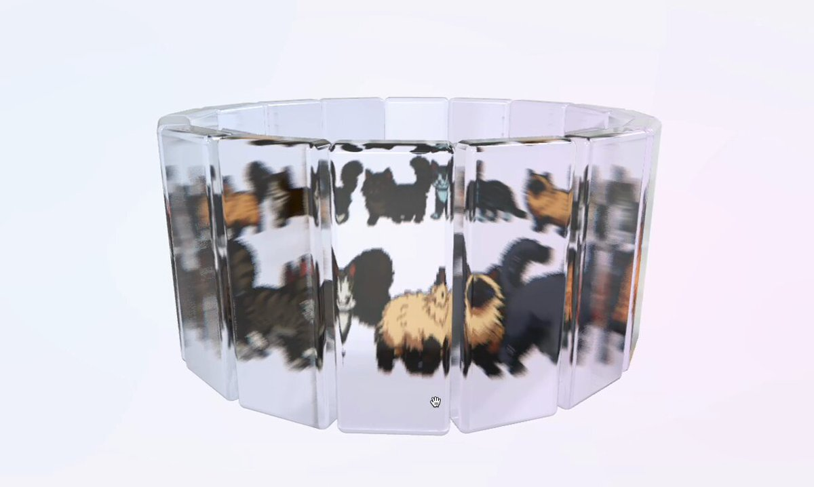](https://github.com/jasonfesta/design-agents/raw/refs/heads/main/resources/sources/motion-references/videos/dnatsuuu-2095073497982935069.mp4)<br>dnatsu🍩 · [MP4](https://github.com/jasonfesta/design-agents/raw/refs/heads/main/resources/sources/motion-references/videos/dnatsuuu-2095073497982935069.mp4) | [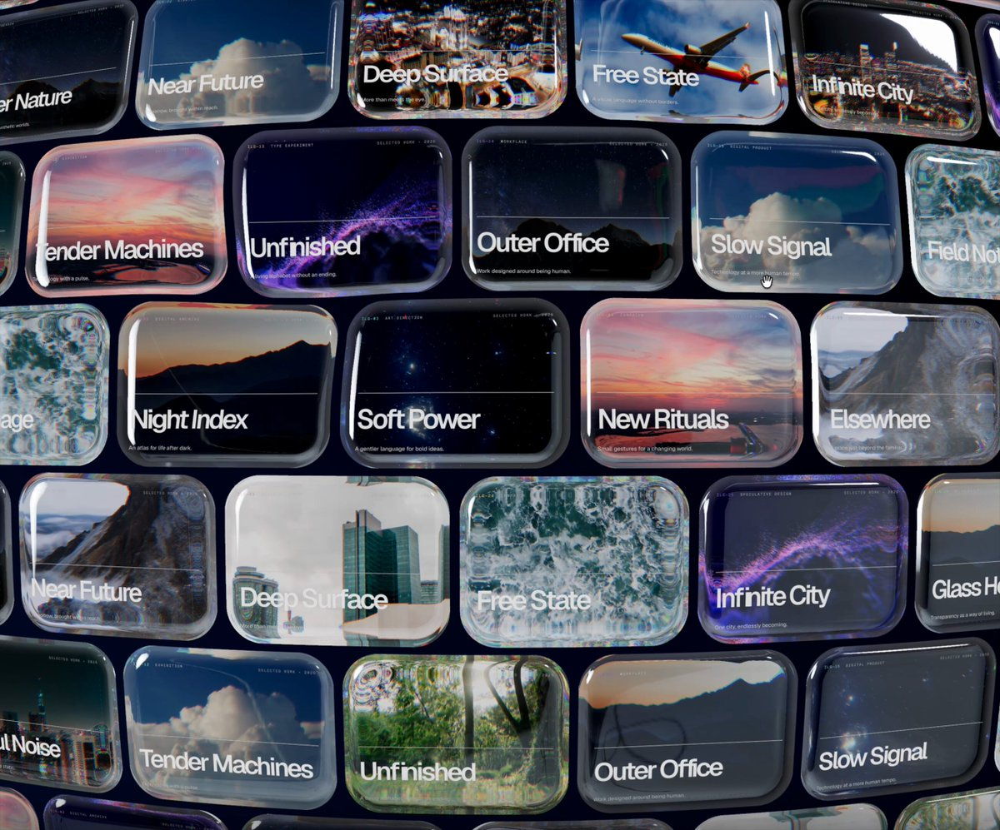](https://github.com/jasonfesta/design-agents/raw/refs/heads/main/resources/sources/motion-references/videos/shadersweden-2095293113086431603.mp4)<br>Shader Development Studio · [MP4](https://github.com/jasonfesta/design-agents/raw/refs/heads/main/resources/sources/motion-references/videos/shadersweden-2095293113086431603.mp4) |
| [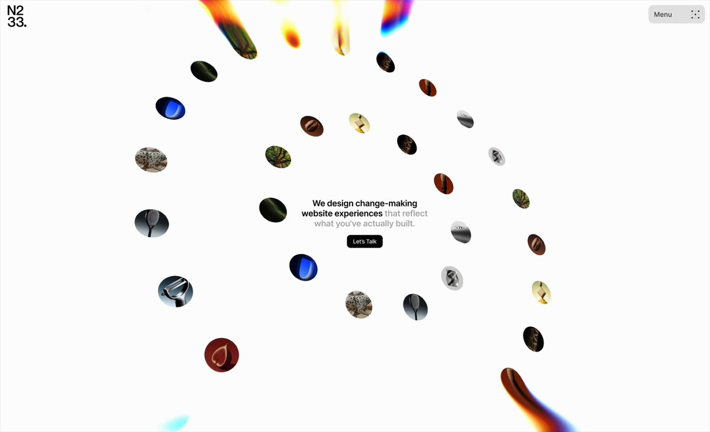](https://github.com/jasonfesta/design-agents/raw/refs/heads/main/resources/sources/motion-references/videos/basit_designs-2095435397828628584.mp4)<br>Basit A. Khan · [MP4](https://github.com/jasonfesta/design-agents/raw/refs/heads/main/resources/sources/motion-references/videos/basit_designs-2095435397828628584.mp4) | [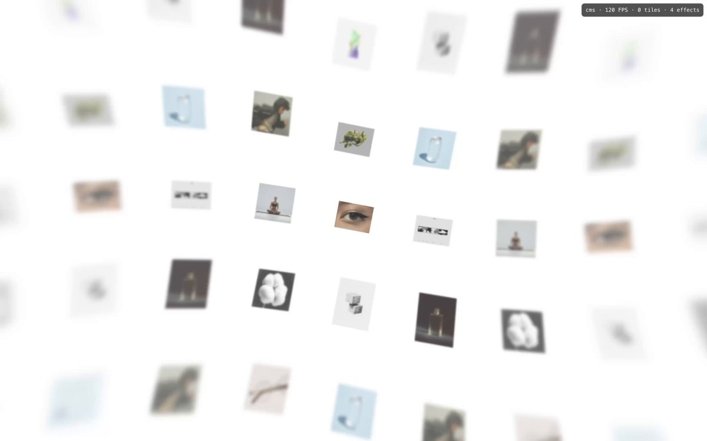](https://github.com/jasonfesta/design-agents/raw/refs/heads/main/resources/sources/motion-references/videos/prszkrtw-2094754060188401708.mp4)<br>Anton Proshkuratov · [MP4](https://github.com/jasonfesta/design-agents/raw/refs/heads/main/resources/sources/motion-references/videos/prszkrtw-2094754060188401708.mp4) |
| [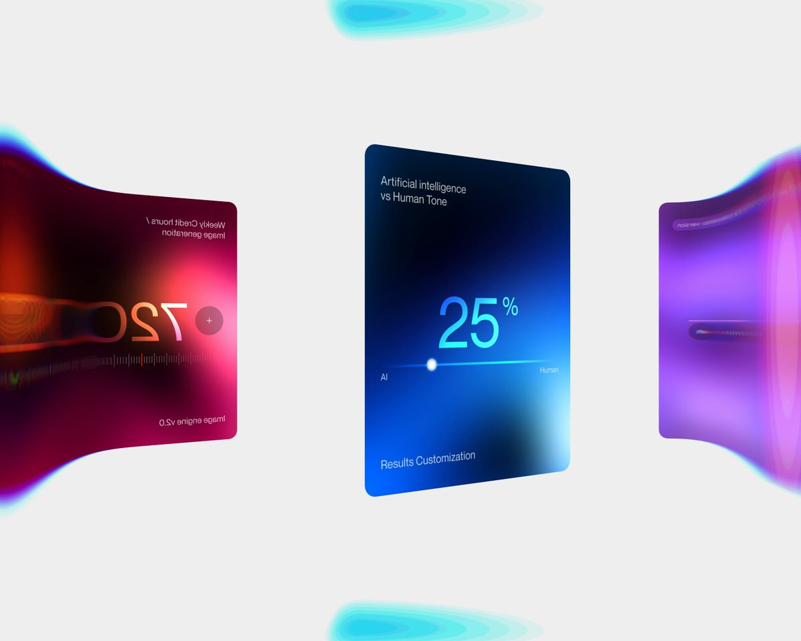](https://github.com/jasonfesta/design-agents/raw/refs/heads/main/resources/sources/motion-references/videos/basit_designs-2099771881159098710.mp4)<br>Basit A. Khan · [MP4](https://github.com/jasonfesta/design-agents/raw/refs/heads/main/resources/sources/motion-references/videos/basit_designs-2099771881159098710.mp4) | [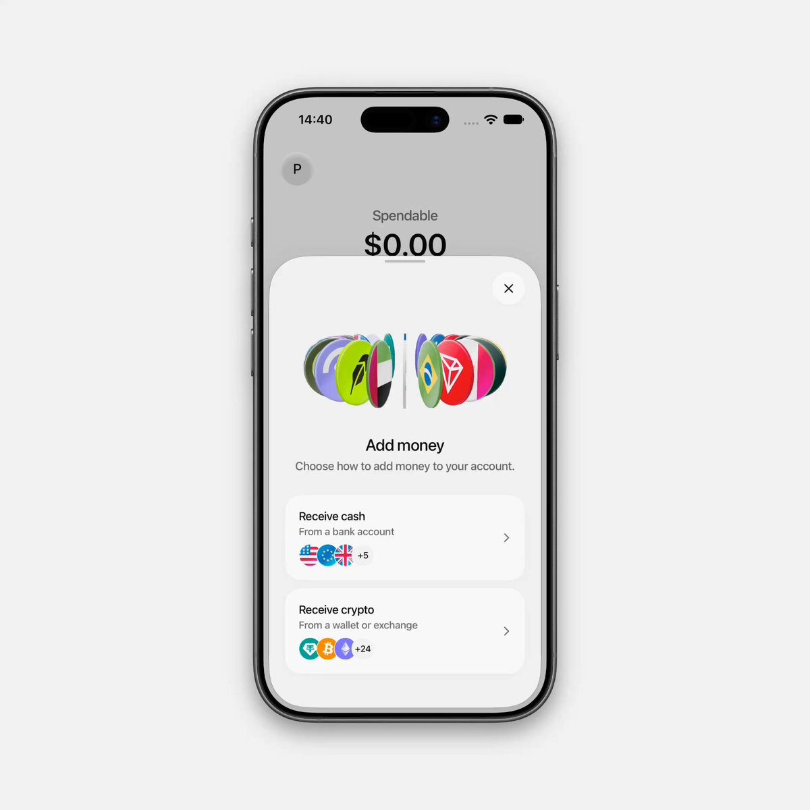](https://github.com/jasonfesta/design-agents/raw/refs/heads/main/resources/sources/motion-references/videos/hollysem-2109628383156170792.mp4)<br>Sergei Semenov · [MP4](https://github.com/jasonfesta/design-agents/raw/refs/heads/main/resources/sources/motion-references/videos/hollysem-2109628383156170792.mp4) |
| [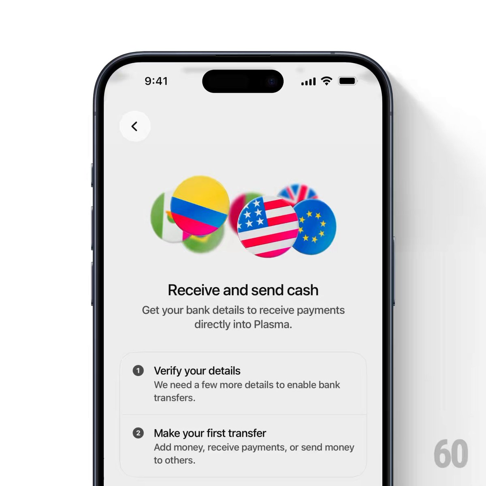](https://github.com/jasonfesta/design-agents/raw/refs/heads/main/resources/sources/motion-references/videos/60fpsdesign-2109604725880762373.mp4)<br>60fps · [MP4](https://github.com/jasonfesta/design-agents/raw/refs/heads/main/resources/sources/motion-references/videos/60fpsdesign-2109604725880762373.mp4) | [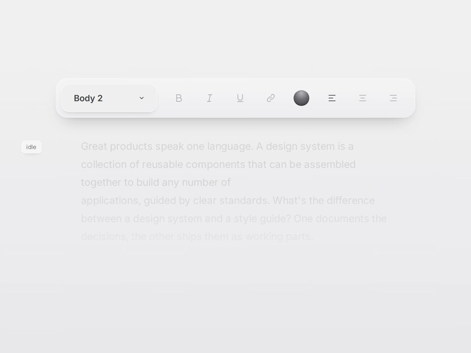](https://github.com/jasonfesta/design-agents/raw/refs/heads/main/resources/sources/motion-references/videos/dezinbyrashi-2109607368480920020.mp4)<br>Rashi · [MP4](https://github.com/jasonfesta/design-agents/raw/refs/heads/main/resources/sources/motion-references/videos/dezinbyrashi-2109607368480920020.mp4) |
| [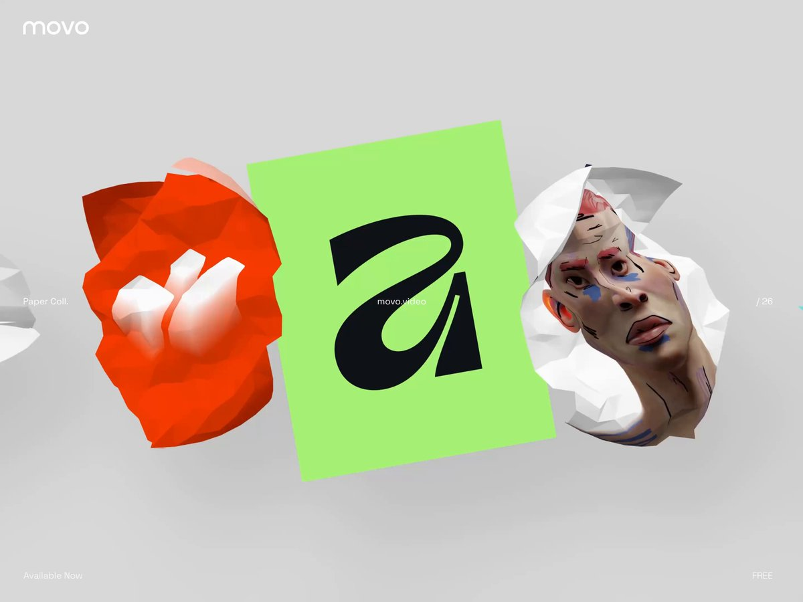](https://github.com/jasonfesta/design-agents/raw/refs/heads/main/resources/sources/motion-references/videos/ricosupply-2109532017582866591.mp4)<br>Rico® Supply · Movo motion experiment · [MP4](https://github.com/jasonfesta/design-agents/raw/refs/heads/main/resources/sources/motion-references/videos/ricosupply-2109532017582866591.mp4) | [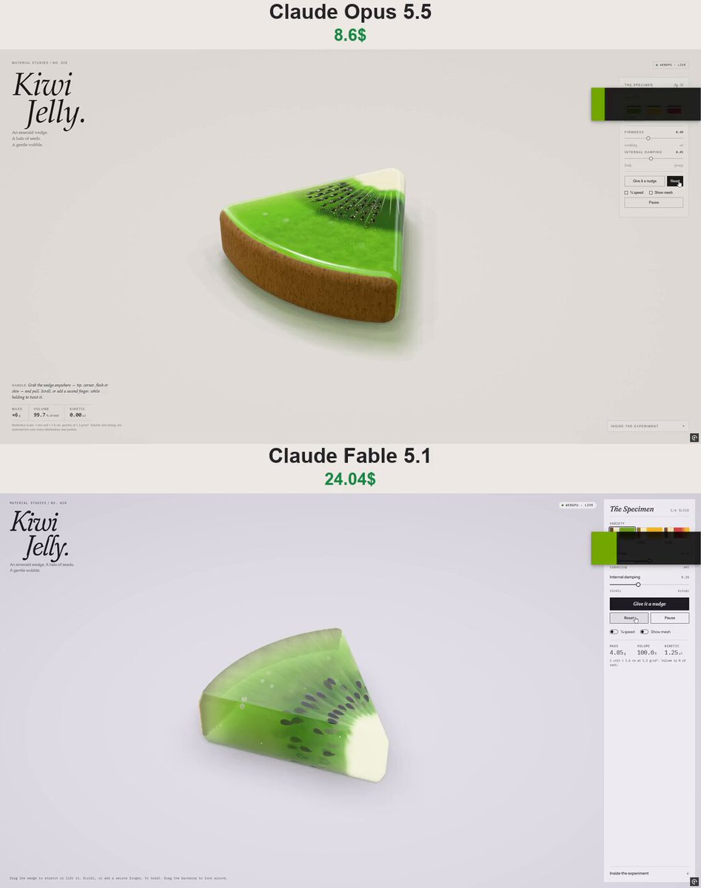](https://github.com/jasonfesta/design-agents/raw/refs/heads/main/resources/sources/motion-references/videos/sahilexec-2109949445853110629.mp4)<br>Edgex · kiwi jelly comparison · [MP4](https://github.com/jasonfesta/design-agents/raw/refs/heads/main/resources/sources/motion-references/videos/sahilexec-2109949445853110629.mp4) |
| [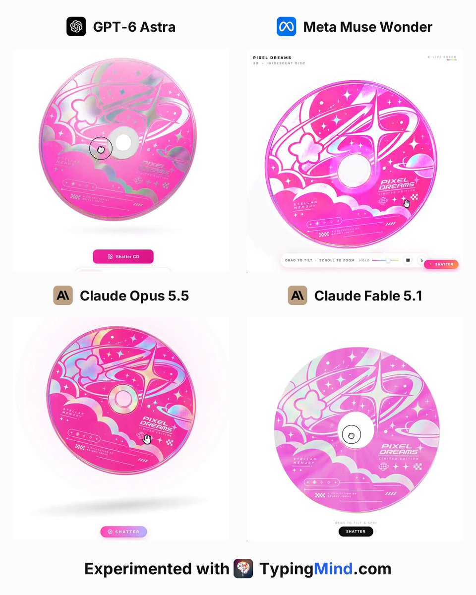](https://github.com/jasonfesta/design-agents/raw/refs/heads/main/resources/sources/motion-references/videos/ann_nnng-2109853948647711057.mp4)<br>Ann Nguyen · holographic CD study · [MP4](https://github.com/jasonfesta/design-agents/raw/refs/heads/main/resources/sources/motion-references/videos/ann_nnng-2109853948647711057.mp4) | [](https://github.com/jasonfesta/design-agents/raw/refs/heads/main/resources/sources/motion-references/images/ann_nnng-2109853948647711057-quoted-finkd.jpg)<br>Quoted reference · Mark Zuckerberg · [JPG](https://github.com/jasonfesta/design-agents/raw/refs/heads/main/resources/sources/motion-references/images/ann_nnng-2109853948647711057-quoted-finkd.jpg) |
| [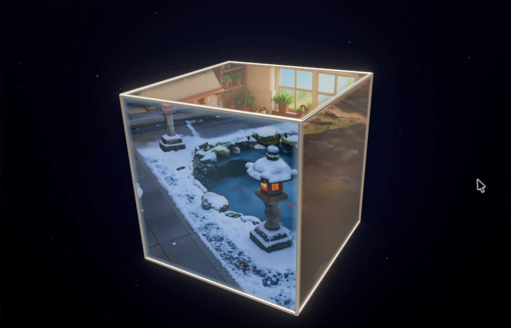](https://github.com/jasonfesta/design-agents/raw/refs/heads/main/resources/sources/motion-references/videos/xrarchitect-2109828750657654819.mp4)<br>Ian Curtis · WebGPU portal cube · [MP4](https://github.com/jasonfesta/design-agents/raw/refs/heads/main/resources/sources/motion-references/videos/xrarchitect-2109828750657654819.mp4) | [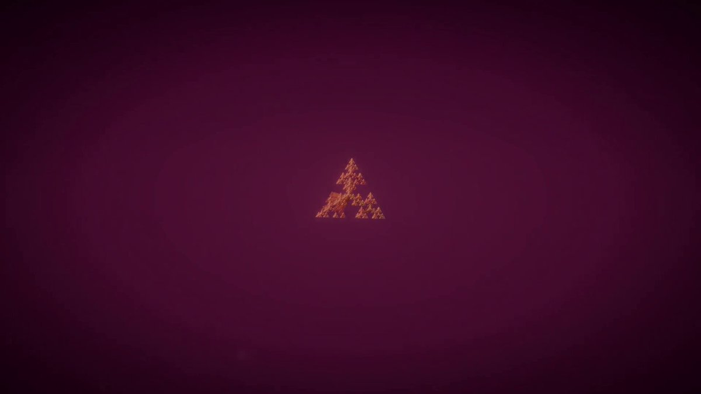](https://github.com/jasonfesta/design-agents/raw/refs/heads/main/resources/sources/motion-references/videos/xrarchitect-2109828750657654819-quoted-2109477956301262848.mp4)<br>Quoted reference · martin_casado · [MP4](https://github.com/jasonfesta/design-agents/raw/refs/heads/main/resources/sources/motion-references/videos/xrarchitect-2109828750657654819-quoted-2109477956301262848.mp4) |
| [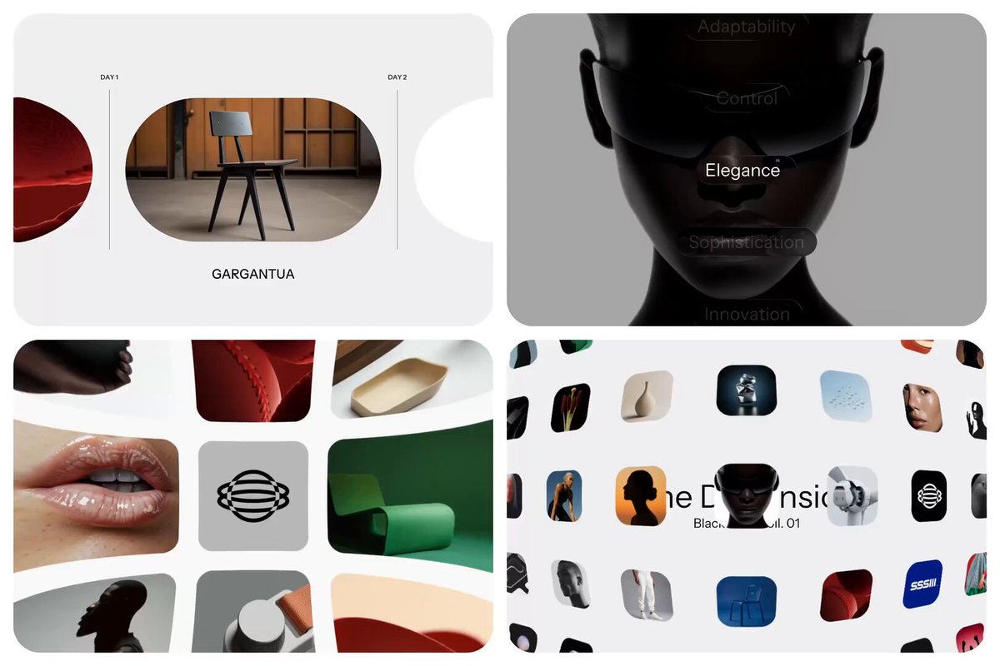](https://github.com/jasonfesta/design-agents/raw/refs/heads/main/resources/sources/motion-references/videos/tweetsbytbi-2100751700831453345.mp4)<br>The Brand Identity · Rico Jitter templates · [MP4](https://github.com/jasonfesta/design-agents/raw/refs/heads/main/resources/sources/motion-references/videos/tweetsbytbi-2100751700831453345.mp4) | [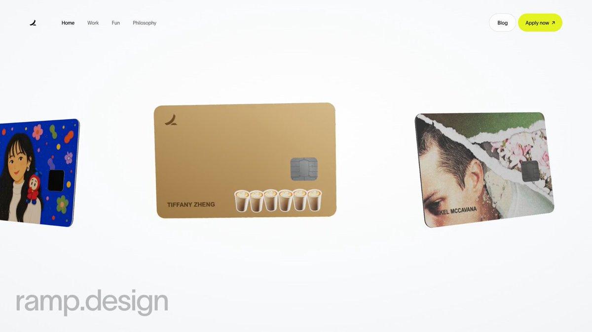](https://github.com/jasonfesta/design-agents/raw/refs/heads/main/resources/sources/motion-references/videos/tiffzheng-2100688715815542984.mp4)<br>Tiffany Zheng · Ramp design site · [MP4](https://github.com/jasonfesta/design-agents/raw/refs/heads/main/resources/sources/motion-references/videos/tiffzheng-2100688715815542984.mp4) |

### Websites

<a id="vitra-media"></a>
<a id="clouarchitects-media"></a>
<a id="alt-studios-media"></a>
<a id="dirtverse-media"></a>
<a id="shopify-editions-media"></a>
<a id="shopify-design-media"></a>
<a id="pacome-media"></a>
<a id="jelly-glass-media"></a>

| Website | Reference | Public contact |
| --- | --- | --- |
| [Augen Pro](https://augen.pro/?ref=godly) | Wearable and neural product website. | — |
| [There’s Nothing to Watch](https://nothing-to-watch.port80.ch/) | Interactive film-poster landscape. | — |
| [Ragged Edge](https://raggededge.com/) | Branding studio and partnership case studies. | [hello@raggededge.com](mailto:hello@raggededge.com) · [New business](mailto:workwithus@raggededge.com) |
| [Vitra · Office Chair Finder](https://findmy.vitra.com/en-en/questionnaire/chairs) | Chair-selection questionnaire. [Saved media](resources/sources/motion-references/README.md#vitra-media). | [info@vitra.com](mailto:info@vitra.com) |
| [Aave](https://aave.com/) | Savings and lending product marketing website. | — |
| [Zikd](https://www.zikd.space/lander) | Currently displays a GoDaddy parked-domain page; original design unavailable on October 13, 2026. | — |
| [Aside](https://aside.com/) | Browser product website with animated interface demonstrations. | — |
| [CLOU architects](https://www.clouarchitects.com/) | Architecture portfolio and studio website. [Saved media](resources/sources/motion-references/README.md#clouarchitects-media). | [info@clouarchitects.com](mailto:info@clouarchitects.com) |
| [Alt Studios](https://alt-studios.com/) | Creative studio website. [Saved media](resources/sources/motion-references/README.md#alt-studios-media). | [info@alt-studios.com](mailto:info@alt-studios.com) |
| [Dirt](https://dirtverse.co/) | Brand and motion website. [Saved media](resources/sources/motion-references/README.md#dirtverse-media). | [hello@dirtverse.co](mailto:hello@dirtverse.co) |
| [Shopify Editions · Winter ’26](https://www.shopify.com/editions/winter2026) | Seasonal product-release website. [Saved media](resources/sources/motion-references/README.md#shopify-editions-media). | — |
| [Shopify Design](https://shopify.design/) | Design team website. [Saved media](resources/sources/motion-references/README.md#shopify-design-media). | — |
| [Pacôme Pertant](https://pacomepertant.com/) | Designer portfolio. [Saved media](resources/sources/motion-references/README.md#pacome-media). | [pertantpacome@gmail.com](mailto:pertantpacome@gmail.com) |

[Infinite Jelly Glass · v2](https://infinite-jelly-glass.shader.se/?v=2) · [Saved videos and media](resources/sources/motion-references/README.md#jelly-glass-media)

## UI downloads

[Open the UI Markdown collection](resources/sources/ui-references/README.md) · [Download / copy the Markdown](https://github.com/jasonfesta/design-agents/raw/refs/heads/main/resources/sources/ui-references/README.md)

| Reference / original post | Download | Public email |
| --- | --- | --- |
| [Eirperuier · streaming SwiftUI](https://x.com/eirperuier/status/2109510794828546355) | [MP4](https://github.com/jasonfesta/design-agents/raw/refs/heads/main/resources/sources/ui-references/videos/eirperuier-2109510794828546355.mp4) | Not publicly found |

| Preview |
| --- |
| [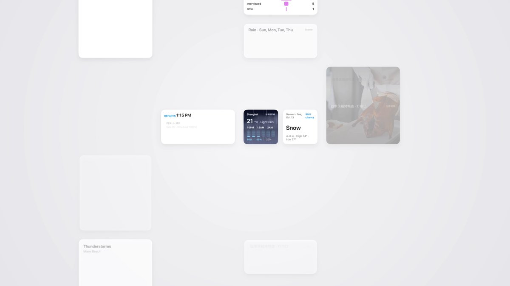](https://github.com/jasonfesta/design-agents/raw/refs/heads/main/resources/sources/ui-references/videos/eirperuier-2109510794828546355.mp4)<br>Eirperuier · streaming SwiftUI · [MP4](https://github.com/jasonfesta/design-agents/raw/refs/heads/main/resources/sources/ui-references/videos/eirperuier-2109510794828546355.mp4) |

## Inspiration

[WebGL / shaders, Product, and Websites](resources/inspiration.md) brings all 40 supplied references together. Product and website entries are links; video references keep their previews and downloads. Spotted in Prod leads the Product section.
